  

### Hey, I'm Leo 👾

**Interested in AI Agents, LLM Post-training & AI Applications.**

关注 **AI Agent、模型后训练、机器学习和 AI 应用开发**。

🎓 **MSc in AI @ HKU** · **BSc in Statistics & Data Science @ LMU Munich**

AI Agents · LLM Post-training · Applied ML · AI Products

---

## 🎮 Things I've been building

### ⚡ OfferFlash — 网申不要再填第十遍了

**AI Product · Desktop Agent · Browser Automation**

秋招时发现，每换一家招聘网站，就得把学校、实习、项目重新填一遍。于是做了一个桌面 Agent：整理简历、在招聘网页上辅助填表，顺手记录投递到了哪一步。

最有意思的不是让模型生成答案，而是让它在**真实、会变化的网页上把动作做对，然后再检查一遍**。

Electron · React · TypeScript · Pi SDK · BrowserController

目前是私有作品集项目，暂不提供公开源码链接。

 

<table>
  <tr>
    <td width="50%" valign="top">
      
      <h3>🌙 <a href="https://github.com/2x2xz/MediHealth-Agent">MediHealth Agent</a></h3>
      
<strong>让睡眠数据更好懂，也更容易用起来。</strong>

      
给普通人做的睡眠助手：把每天的记录、整夜报告和有来源的解释放到同一个工作区。在完整 Agent 模式下，还能围绕数据继续提问。

      
LangGraph · Tools & Skills · Retrieval · SQLite

      
<a href="https://github.com/2x2xz/MediHealth-Agent">See the project →</a>

    </td>
    <td width="50%" valign="top">
      
      <h3>🏨 <a href="https://github.com/2x2xz/StayAgent-RL">StayAgent-RL</a></h3>
      
<strong>一个 2B 模型，能独立完成多少步工具操作？</strong>

      
搭了 StaySimulator，让 Qwen3.5-2B 练习搜房、核验条件、模拟预订；再用 LoRA SFT 和 Online GRPO 训练，记录它变好的地方和仍然会犯的错。

      
Qwen3.5-2B · LoRA SFT · GRPO · veRL / vLLM

      
<a href="https://github.com/2x2xz/StayAgent-RL">See the experiment →</a>

    </td>
  </tr>
</table>

---

  <a href="https://github.com/2x2xz?tab=repositories">More repositories ↗</a>

 

<picture>
  <source media="(prefers-color-scheme: dark)" srcset="https://raw.githubusercontent.com/2x2xz/2x2xz/output/github-snake-dark.svg?v=1" />
  <source media="(prefers-color-scheme: light)" srcset="https://raw.githubusercontent.com/2x2xz/2x2xz/output/github-snake.svg?v=1" />
  
</picture>

GitHub contribution snake · <a href="https://github.com/Platane/snk">powered by snk</a>

<samp>+ keep exploring. keep building. +</samp>

