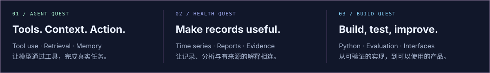

  

  <a href="https://github.com/2x2xz/MediHealth-Agent"><b>Explore MediHealth ↗</b></a>
  &nbsp;&nbsp; / &nbsp;&nbsp;
  <a href="https://github.com/2x2xz?tab=repositories">Repositories</a>

### `> player.info` &nbsp; Hi, I'm Xiuze 👾

我关注 **AI Agent、睡眠健康与机器学习应用**，喜欢把模型、工具和数据串起来，做成能够实际使用的产品。

I'm interested in AI agents, sleep & health, and applied machine learning — connecting models, tools, and data to build useful software.

  <code>Python</code> &nbsp; <code>LangGraph</code> &nbsp; <code>Retrieval</code> &nbsp; <code>SQLite</code> &nbsp; <code>Time-series analysis</code>

 

 

### `> quest.showcase` &nbsp; 近期作品

<table>
  <tr>
    <td>
      <h3>☾ &nbsp; MediHealth Agent</h3>
      
<b>让睡眠记录，成为有依据的交流。</b>

      
从一周的日常变化，到一份整夜睡眠报告，把记录、分析与有来源的解释，放进同一个工作区。

      
<code>Python</code> <code>LangGraph</code> <code>SQLite</code> <code>Local-first UI</code>

      
      
真实界面录制 · 人工合成记录与报告 · 无模型预览

      
<a href="https://github.com/2x2xz/MediHealth-Agent"><b>查看项目与运行说明 →</b></a> &nbsp; · &nbsp; <a href="https://github.com/2x2xz/MediHealth-Agent/blob/main/docs/reproduction.md">复现指南</a>

    </td>
  </tr>
</table>

 

### `> snake.run` &nbsp; 吃掉每一格努力

<picture>
  <source media="(prefers-color-scheme: dark)" srcset="https://raw.githubusercontent.com/2x2xz/2x2xz/output/github-snake-dark.svg" />
  <source media="(prefers-color-scheme: light)" srcset="https://raw.githubusercontent.com/2x2xz/2x2xz/output/github-snake.svg" />
  
</picture>

GitHub 贡献日历 · 每日自动更新 · <a href="https://github.com/Platane/snk">powered by snk</a>

 

<samp>+ keep exploring. keep building. +</samp>

