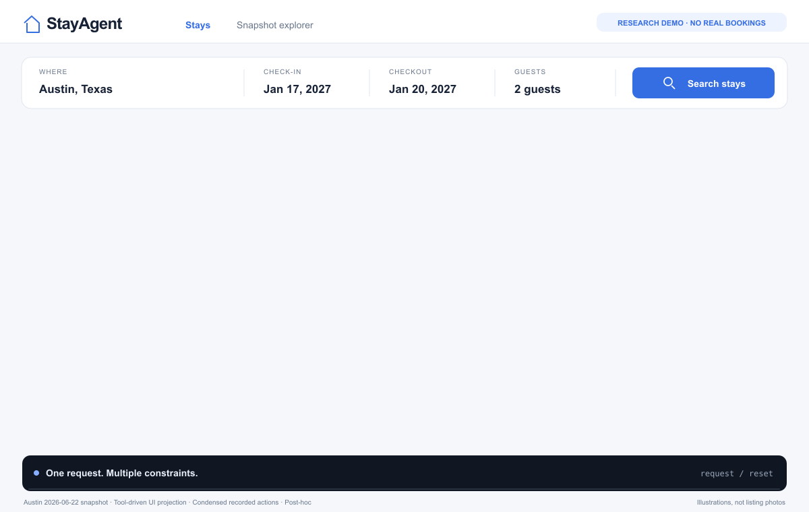

# StayAgent-RL

**让小模型学会多步工具决策。**

StayAgent-RL 以住宿预订为任务场景，围绕 **Baseline → LoRA SFT → Online GRPO → Evaluation** 搭建工具智能体后训练流程。模型需要通过搜索房源、查看详情、核验条件等工具，逐步决定预订或结束任务。

`Qwen3.5-2B` · `LoRA SFT` · `veRL` · `vLLM` · `StaySimulator`

已有工具动作的环境重放与界面呈现；不是实时模型推理，也不连接真实预订或支付服务。[查看静态画面](../assets/stayagent-demo.png)

## 一个任务如何完成

给定入住日期、人数、预算、房型与设施要求，Agent 只能读取当前工具返回的信息，不能直接访问完整数据库或目标答案。

1. **搜索候选。** 根据约束检索房源，必要时调整搜索条件。
2. **核验信息。** 打开详情、检查设施与政策，核对多晚总价和入住条件。
3. **做出决策。** 对合格房源执行模拟预订；没有合适候选时结束任务。

## 从示范学习到在线强化学习

| 环节 | 具体工作 |
| --- | --- |
| 任务与环境 | 将冻结住宿数据整理为多约束任务，在 StaySimulator 中检查预订结果与奖励 |
| LoRA SFT | 使用经过筛选的工具交互轨迹，让模型学习动作格式与多步决策过程 |
| Online GRPO | 通过 veRL Agent Loop 与 vLLM 采样，让模型在环境交互中接收奖励并更新策略 |
| 评测与诊断 | 固定任务、工具与评分规则，区分失败反馈丢失、上下文溢出、重复搜索和步数耗尽 |

针对长任务，还实现了终止动作适配与按完整工具调用组压缩历史的处理，并分别检查训练变化和推理设置变化的效果。

## 展示与来源说明

项目的界面演示将一条已有轨迹的 **29 次工具动作、6 个候选**投影到住宿界面。环境状态与模拟预订结果来自 StaySimulator 的离线重放，候选名称经过别名化处理，房间图为示意插画。

原 Agent 使用结构化工具；该界面是展示层。案例来自 GRPO step500 加上下文压缩、50 步上限的后续探索，不能作为正式 35 步协议下的新评测结果。

数据来源为 [Inside Airbnb](https://insideairbnb.com/get-the-data/) 的 Austin 2026-06-22 冻结快照，依照其 CC BY 4.0 署名要求保留来源。价格采用快照中的每晚价格，不包含税费、清洁费与平台费。

训练与实验骨架基于 [shopping-grpo-longhorizon](https://github.com/YYHDBL/shopping-grpo-longhorizon) 适配，原始基线提交为 `4ed73020e1d7d07eb93e7375a4606b0901d3cded`。StayAgent 的工作包括住宿数据与任务、模拟环境、预订工具与奖励、训练适配及评测诊断。

本页公开项目介绍与演示素材，完整代码仓库目前保持私有。

[← 返回 Leo 的主页](https://github.com/2x2xz)
